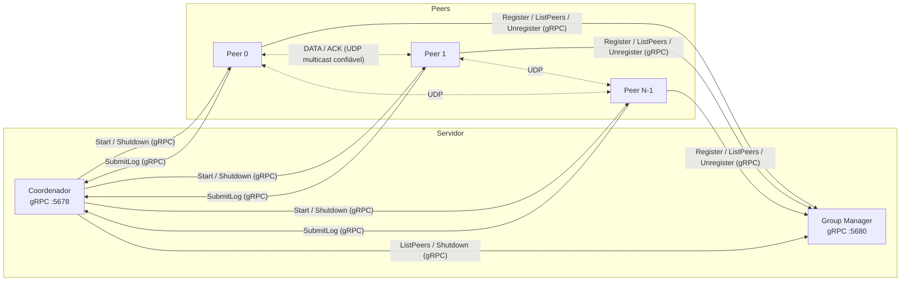
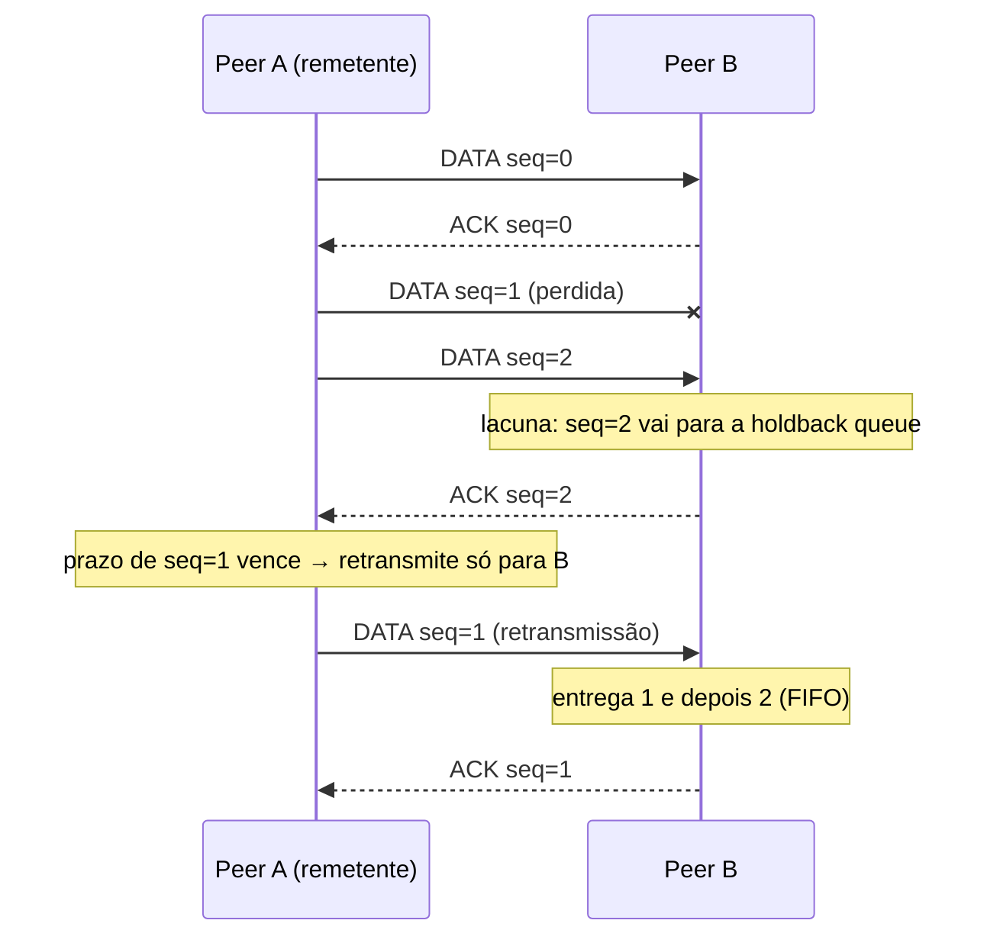

# MPComm – RPC e multicast confiável com ordenação FIFO

[](https://github.com/fernandes-emmanuel/trabalho-final-sd-pt-1/actions/workflows/ci.yml)

Parte 1 do trabalho final de Sistemas Distribuídos. O ponto de partida é o
[MPComm](https://github.com/professorfabio/MPComm), um sistema de comunicação multicast sem
coordenação usado para mostrar o problema da escalabilidade geográfica. Esta versão faz duas
melhorias nos protocolos de comunicação:

- **(a)** todas as interações cliente-servidor passam a usar **RPC (gRPC)** em vez de sockets TCP
  com `pickle`. Há também uma comparação qualitativa e quantitativa entre as duas abordagens;
- **(b)** o multicast entre os peers **continua sobre sockets UDP**, mas agora trata **perda de
  mensagens** (confirmações e retransmissão) e garante **ordenação FIFO** por remetente.

## Sumário

1. [Funcionalidades](#funcionalidades)
2. [Arquitetura](#arquitetura)
3. [Parte 1a – Sockets substituídos por RPC](#parte-1a--sockets-substituídos-por-rpc)
4. [Parte 1b – Multicast confiável com ordenação FIFO](#parte-1b--multicast-confiável-com-ordenação-fifo)
5. [Defeitos do código-base corrigidos](#defeitos-do-código-base-corrigidos)
6. [Como executar](#como-executar)
7. [Experimentos e resultados](#experimentos-e-resultados)
8. [Testes](#testes)
9. [Estrutura do repositório](#estrutura-do-repositório)
10. [Limitações](#limitações)

## Funcionalidades

- **Group manager** (serviço de membership) acessado via gRPC: `Register`, `Unregister`,
  `ListPeers` e `Shutdown`.
- **Peers** que trocam mensagens por multicast UDP com entrega **confiável**, **sem duplicatas** e
  em **ordem FIFO**, mesmo com perda, duplicação e reordenação de pacotes.
- **Coordenador** (o antigo `comparisonServer`) que dispara as rodadas via RPC, recebe os logs via
  RPC e verifica automaticamente:
  - completude: cada peer recebeu `N × M` mensagens;
  - duplicatas;
  - violações de ordem FIFO;
  - divergência de ordem total entre os peers (a métrica original, corrigida).
- **Injeção de falhas na aplicação** (perda, duplicação, atraso e jitter, com *seed* para
  reprodutibilidade) e **injeção de falhas no kernel** via `tc netem` nos contêineres Docker.
- **RTO adaptativo** (Jacobson/Karels, com o algoritmo de Karn) e *backoff* exponencial.
- **Detecção de peers inalcançáveis**: o peer desiste depois de um tempo configurável, em vez de
  travar para sempre.
- Execução **local com um único comando**, execução **distribuída com Docker Compose**, simulando
  duas regiões geográficas, e execução em **máquinas reais/nuvem**.
- Relatórios em texto e em JSON, testes automatizados e integração contínua no Linux e no Windows.

## Arquitetura



Cada processo é organizado em camadas com responsabilidades bem separadas:

| Camada | Módulos | Responsabilidade |
|---|---|---|
| Aplicação/orquestração | `peer/node.py`, `peer/round.py`, `coordinator/` | Ciclo de vida do peer, rodadas do experimento, análise dos logs |
| Membership | `membership/group_manager.py` | Registro e descoberta dos peers |
| RPC | `protos/…/mpcomm.proto`, `rpc/` | Contrato, clientes com *deadline* e servidores gRPC |
| Multicast confiável | `transport/reliable.py` | Sequenciamento, ACKs, retransmissão, *holdback queue*, FIFO |
| Transporte | `transport/udp.py`, `transport/faults.py`, `transport/messages.py` | Socket UDP, injeção de falhas, formato das mensagens |

As dependências apontam sempre para baixo. O protocolo de multicast confiável não conhece sockets
nem gRPC: recebe um `Channel` (qualquer objeto com `send(data, address)`) e um relógio. Por isso ele
pode ser testado de forma determinística com uma rede simulada.

## Parte 1a – Sockets substituídos por RPC

### Contrato

O contrato está em [`protos/mpcomm/rpc/mpcomm.proto`](protos/mpcomm/rpc/mpcomm.proto). Os stubs
Python gerados ficam em `mpcomm/rpc/` e podem ser regenerados com
`python scripts/generate_protos.py`.

```protobuf
service GroupManager {
  rpc Register(RegisterRequest) returns (RegisterReply);
  rpc Unregister(UnregisterRequest) returns (Empty);
  rpc ListPeers(Empty) returns (PeerList);
  rpc Shutdown(Empty) returns (Empty);
}

service PeerControl {
  rpc Start(StartRequest) returns (StartReply);
  rpc Shutdown(Empty) returns (Empty);
}

service Comparison {
  rpc SubmitLog(RoundLog) returns (Empty);
}
```

### Mapeamento das interações

| Interação | Original (socket TCP + `pickle`) | Esta versão (gRPC) |
|---|---|---|
| Peer se registra | `{"op": "register", ...}` sem resposta | `GroupManager.Register` → devolve o `peer_id` |
| Descoberta dos peers | `{"op": "list"}` → lista de IPs | `GroupManager.ListPeers` → `id`, host, porta UDP e porta de controle |
| Peer sai do grupo | `unregister` não implementado | `GroupManager.Unregister` (`NOT_FOUND` se não existir) |
| Início de rodada | tupla `(peerNumber, nMsgs)` na porta TCP do peer | `PeerControl.Start(round_id, messages_per_peer, report_to)` |
| Envio do log | `pickle` do log inteiro em um único `recv(32768)` | `Comparison.SubmitLog(RoundLog)` com estatísticas do protocolo |
| Encerramento | `nMsgs = 0` e `{"op": "stop"}` | `PeerControl.Shutdown` e `GroupManager.Shutdown` |

Duas decisões de projeto merecem destaque:

- **O `peer_id` é atribuído pelo group manager no registro.** Antes ele dependia da ordem em que o
  coordenador contatava os peers. Agora o identificador é estável e conhecido por todos via
  `ListPeers`.
- **O coordenador informa no `Start` para onde o log deve ser enviado (`report_to`).** Assim o
  peer não precisa ter o endereço do coordenador fixo no código (`SERVER_ADDR`). Basta conhecer o
  group manager.

### Vantagens e desvantagens

| Aspecto | Sockets + `pickle` | RPC (gRPC) |
|---|---|---|
| Contrato da interface | Implícito: dicionários e tuplas montados à mão nos dois lados | Explícito e tipado no `.proto`; os stubs são gerados |
| Enquadramento das mensagens | Inexistente: `recv(N)` pode cortar ou juntar mensagens | Resolvido pelo HTTP/2 + Protobuf |
| Segurança da serialização | `pickle.loads` de dados da rede permite execução remota de código | Protobuf só desserializa dados |
| Tratamento de erros | Exceções genéricas ou travamento; operação desconhecida fica sem resposta | Códigos de status padronizados (`INVALID_ARGUMENT`, `NOT_FOUND`, `UNAVAILABLE`, `UNIMPLEMENTED`…) |
| Timeouts | Não existem: `recv` bloqueia indefinidamente | *Deadline* por chamada; `wait_for_ready` para aguardar o servidor subir |
| Concorrência no servidor | Laço sequencial de `accept` | *Pool* de threads do gRPC |
| Evolução e interoperabilidade | Qualquer mudança quebra os dois lados; `pickle` é exclusivo de Python | Campos novos são compatíveis; há clientes para dezenas de linguagens |
| Quantidade de código | Pequena, mas repetitiva (abrir socket, serializar, enviar, fechar) | Chamadas de uma linha, a partir dos stubs |
| Dependências | Só a biblioteca padrão | `grpcio` e `protobuf`, mais uma etapa de geração de código |
| Overhead | Mínimo: TCP puro | HTTP/2, cabeçalhos e estabelecimento de canal |
| Controle e depuração | Total; o tráfego é fácil de inspecionar | Mais opaco: código gerado e tráfego binário |
| Comunicação em grupo | Possível (UDP) | Não se aplica: RPC é ponto a ponto, por isso o multicast continua em sockets |

### Medição

O script [`benchmarks/rpc_vs_socket.py`](benchmarks/rpc_vs_socket.py) executa a mesma operação
(`list`) com o protocolo original (socket TCP, `pickle`, uma conexão por requisição e
`recv(2048)`) e com o gRPC, com canal novo a cada chamada e com canal persistente. Foram 2000
chamadas em localhost, num Windows 11 com Python 3.14:

| Implementação | Peers | Falhas | Média (ms) | p50 (ms) | p95 (ms) | Requisição (B) | Resposta (B) |
|---|---:|---:|---:|---:|---:|---:|---:|
| socket + pickle (original) | 6 | 0 | 0,310 | 0,298 | 0,483 | 27 | 82 |
| gRPC, canal novo por chamada | 6 | 0 | 0,607 | 0,591 | 0,900 | 0 | 118 |
| gRPC, canal persistente | 6 | 0 | 0,392 | 0,364 | 0,616 | 0 | 118 |
| socket + pickle (original) | 300 | **2000 (100%)** | – | – | – | 27 | 3749 |
| gRPC, canal novo por chamada | 300 | 0 | 1,222 | 1,194 | 1,750 | 0 | 6603 |
| gRPC, canal persistente | 300 | 0 | 1,012 | 0,990 | 1,417 | 0 | 6603 |

Leitura dos resultados:

- **Grupos pequenos:** o socket puro é cerca de 20% mais rápido que o gRPC com canal persistente
  e duas vezes mais rápido que o gRPC com canal novo por chamada. É o custo do HTTP/2 e da
  negociação do canal, e por isso os clientes desta versão reutilizam o canal sempre que possível.
- **Grupos maiores:** com 300 peers, a lista serializada passa de 2048 bytes e o protocolo
  original **falha em 100% das chamadas**. O `recv(2048)` corta a mensagem e o `pickle.loads`
  falha. O gRPC continua funcionando sem nenhuma mudança, porque o enquadramento é responsabilidade
  do framework.
- **Tamanho das mensagens:** a resposta do gRPC é maior porque carrega mais informação: `id` e
  portas de cada peer, não só o IP. A requisição vazia ocupa 0 bytes em Protobuf.

**Conclusão:** para as interações cliente-servidor deste sistema, que são de controle, pouco
frequentes e fora do caminho crítico das mensagens, a diferença de latência em sub-milissegundos é
irrelevante. Já os ganhos em robustez, segurança e clareza da interface são decisivos. O multicast,
que é o caminho crítico e precisa de comunicação em grupo, permanece em UDP.

## Parte 1b – Multicast confiável com ordenação FIFO

### Formato das mensagens

As mensagens UDP são JSON (o `pickle` foi eliminado também aqui):

```json
{"type": "data", "round": 1794947084, "sender": 2, "seq": 17, "kind": "data", "payload": 15}
{"type": "ack",  "round": 1794947084, "acker": 0, "origin": 2, "seq": 17}
```

| Campo | Significado |
|---|---|
| `round` | Identificador da rodada; pacotes de outras rodadas são isolados |
| `sender`, `seq` | Remetente e número de sequência local do remetente, começando em 0 |
| `kind` | `hello` (handshake), `data` (mensagem do experimento) ou `end` (fim do envio) |
| `acker`, `origin` | Quem confirma e quem enviou a mensagem confirmada |

### Algoritmo

**Remetente**, em [`transport/reliable.py`](mpcomm/transport/reliable.py):

1. Atribui o próximo número de sequência e envia a mensagem a todos os membros do grupo,
   inclusive a si mesmo.
2. Guarda a mensagem num buffer de não confirmadas, junto com o conjunto de membros que ainda não
   mandaram ACK.
3. Uma thread de retransmissão verifica os prazos a cada 10 ms. Quando o prazo de uma mensagem
   vence, ela é reenviada **somente** aos membros que ainda não confirmaram, e o prazo dobra
   (*backoff* exponencial, até 2 s).
4. O prazo inicial vem de um estimador de RTT (Jacobson/Karels: `RTO = SRTT + 4·RTTVAR`). Segundo o
   algoritmo de Karn, amostras de mensagens retransmitidas são descartadas, por serem ambíguas.
5. Se um membro não confirma durante `give_up_after` (30 s), ele é declarado **inalcançável** e
   deixa de ser esperado. A rodada termina e é marcada como incompleta, em vez de travar.

**Receptor:**

1. **Sempre** responde com ACK, inclusive a duplicatas, porque o ACK anterior pode ter se perdido.
2. Para cada remetente, mantém `next_expected` e uma *holdback queue*:
   - `seq < next_expected` ou já está na fila: é duplicata e é descartada;
   - `seq > next_expected`: há uma lacuna, e a mensagem fica retida na *holdback queue*;
   - `seq == next_expected`: a mensagem é entregue, e em seguida todas as mensagens consecutivas
     que estavam retidas.



### Handshake e fim também confiáveis

No código original, o handshake `READY` e o marcador de fim `(-1, -1)` eram datagramas UDP
avulsos: bastava perder um deles para o sistema travar. Agora `HELLO` e `END` são mensagens
sequenciadas do próprio protocolo confiável. Por isso:

- a barreira inicial só libera o envio de dados depois que o `HELLO` de **todos** foi entregue, e
  um `HELLO` perdido é simplesmente retransmitido;
- como a entrega é FIFO, receber o `END` de um remetente **garante** que todas as mensagens
  anteriores dele já foram entregues. É essa a condição de término da rodada.

A espera ativa original (`while handShakeCount < N: pass`, que ocupava 100% de uma CPU) foi
substituída por `threading.Event`.

### Isolamento entre rodadas

Cada rodada tem um `round_id` próprio. Pacotes de uma rodada que ainda não começou localmente são
ignorados sem ACK (o remetente retransmite depois). Pacotes atrasados de uma rodada já encerrada
recebem ACK, para o remetente não ficar retransmitindo à toa, e não são entregues de novo.

### FIFO não é ordem total

Com FIFO, as mensagens de **um mesmo remetente** chegam na ordem em que foram enviadas. Mensagens
de **remetentes diferentes**, porém, podem ser entregues em ordens diferentes em cada peer. O
coordenador continua medindo isso, e os experimentos abaixo mostram que a divergência de ordem
total permanece. Esse é justamente o problema que as próximas partes do trabalho atacam.

## Defeitos do código-base corrigidos

| Defeito no MPComm original | Correção |
|---|---|
| Comparação com *off-by-one*: `range(0, N_MSGS-1)` ignora a última posição e `range(1, N-1)` ignora o último peer; além disso, só as `N_MSGS-1` primeiras de `N × N_MSGS` posições são comparadas | `coordinator/analysis.py` compara todas as posições de todos os peers e trata logs de tamanhos diferentes |
| TCP sem enquadramento: `recv(2048)` e `recv(32768)` cortam mensagens grandes | gRPC |
| `pickle.loads` de dados da rede (execução remota de código) | Protobuf no RPC e JSON no UDP |
| Espera ativa pelos handshakes e contador global sem sincronização | `threading.Event` e `Condition` |
| Handshake e marcador de fim por UDP sem confirmação: um pacote perdido trava o sistema | `HELLO` e `END` confiáveis |
| `conn.close()` fora do laço do group manager: conexões vazam | gRPC gerencia as conexões |
| `unregister` não implementado; operação desconhecida fica sem resposta | `Unregister` implementado; `UNIMPLEMENTED` automático |
| IPs fixos em `constMP.py` e uma porta fixa por máquina | Configuração por argumentos/variáveis de ambiente; vários peers por máquina |
| Descoberta do IP público por um serviço externo (`api.ipify.org`) | `--advertise-host`, detectado automaticamente na rede local/Docker |
| Número de peers `N` constante em todos os processos | O grupo é o que o group manager informa em cada rodada |
| No Windows, um `ICMP port unreachable` derruba o `recvfrom` UDP (`WSAECONNRESET`) | `SIO_UDP_CONNRESET` desativado no socket |

## Como executar

### Pré-requisitos

- Python 3.11 ou superior
- Docker com Compose, para o cenário distribuído

```bash
python -m venv .venv
source .venv/bin/activate        # Windows: .venv\Scripts\activate
pip install -e ".[dev]"
```

### 1. Experimento completo em localhost com um comando

```bash
mpcomm local --peers 6 --messages 30 --rounds 2
mpcomm local --peers 6 --messages 30 --loss 0.2 --duplication 0.05 --delay-ms 5 --jitter-ms 20 --seed 42 --report results/local.json
```

O comando sobe o group manager, os peers e o coordenador como processos separados, executa as
rodadas, imprime o relatório e encerra tudo. O código de saída é `0` quando todas as rodadas
tiveram entrega confiável e FIFO.

### 2. Processos em terminais separados (como no MPComm original)

```bash
mpcomm group-manager --listen 0.0.0.0:5680

mpcomm peer --group-manager 127.0.0.1:5680 --advertise-host 127.0.0.1 --udp-port 6789 --control-port 5679
mpcomm peer --group-manager 127.0.0.1:5680 --advertise-host 127.0.0.1 --udp-port 6790 --control-port 5690

mpcomm coordinator --group-manager 127.0.0.1:5680 --advertise-host 127.0.0.1 --peers 2
```

Sem `--messages`, o coordenador funciona em modo interativo, como o original: pergunta o número
de mensagens por peer e encerra todo o sistema quando recebe `0`.

### 3. Duas "regiões geográficas" com Docker

O [`docker-compose.yml`](docker-compose.yml) cria 4 peers na **região A** (latência de 2 ms ± 1 ms)
e 2 peers na **região B** (latência de 120 ms ± 60 ms e 10% de perda). Os atrasos e perdas são
aplicados de verdade no kernel, com `tc netem`, e valem para todo o tráfego de cada contêiner.

```bash
docker compose up -d --build
docker compose run --rm coordinator                                       # interativo
docker compose run --rm coordinator mpcomm coordinator --peers 6 --messages 30 --rounds 3 --report results/docker.json
docker compose down
```

As condições de rede podem ser trocadas sem editar arquivos:

```bash
REGION_B_NETEM="delay 200ms 100ms loss 25%" docker compose up -d --force-recreate
```

### 4. Máquinas reais ou nuvem

O código não tem endereços fixos. Em cada máquina, basta informar onde está o group manager e o
endereço pelo qual a máquina é alcançada:

```bash
mpcomm group-manager                                                            # servidor
mpcomm peer --group-manager <IP_DO_SERVIDOR>:5680 --advertise-host <IP_PUBLICO_DO_PEER>
mpcomm coordinator --group-manager <IP_DO_SERVIDOR>:5680 --advertise-host <IP_PUBLICO_DO_SERVIDOR> --peers 8
```

Portas que precisam estar liberadas: 5680/TCP e 5678/TCP no servidor; 6789/UDP e 5679/TCP nos
peers. Todas as opções também aceitam variáveis de ambiente (`MPCOMM_GROUP_MANAGER`,
`MPCOMM_ADVERTISE_HOST`, `MPCOMM_LOSS`…).

## Experimentos e resultados

### Entrega sob perda crescente

O script [`benchmarks/loss_experiment.py`](benchmarks/loss_experiment.py) executou 6 peers × 30
mensagens × 3 rodadas por cenário, com atraso de 5 ms ± 10 ms e *seed* fixa. Cada cenário deve
entregar 3240 mensagens (6 peers × 180 mensagens × 3 rodadas).

| Perda | Entregues | Violações FIFO | Duplicatas entregues | Pacotes descartados | Retransmissões | Duplicatas descartadas | Retidas na holdback | Segundos por rodada |
|---:|---:|---:|---:|---:|---:|---:|---:|---:|
| 0% | 3240/3240 | 0 | 0 | 0 | 29 | 7 | 135 | 2,5 |
| 10% | 3240/3240 | 0 | 0 | 873 | 893 | 415 | 516 | 3,3 |
| 20% | 3240/3240 | 0 | 0 | 1905 | 1922 | 810 | 899 | 6,7 |
| 30% | 3240/3240 | 0 | 0 | 3571 | 3591 | 1512 | 1468 | 18,6 |
| 40% | 3240/3240 | 0 | 0 | 6072 | 6103 | 2232 | 2145 | 28,1 |

- **Nenhuma mensagem foi perdida e nenhuma ordem FIFO foi violada**, mesmo com 40% de perda.
- O número de retransmissões acompanha de perto o de pacotes descartados: o protocolo retransmite
  só o necessário, e só para quem não confirmou.
- As "duplicatas descartadas" surgem quando o que se perdeu foi o ACK, não a mensagem. O receptor
  confirma de novo e descarta a cópia, então a aplicação nunca recebe duplicatas.
- O preço da confiabilidade é tempo: com 40% de perda, a rodada leva cerca de 11 vezes mais do que
  sem perda, por causa do *backoff* exponencial.
- Mesmo sem perda há retransmissões e mensagens retidas: o jitter faz pacotes chegarem fora de
  ordem e, de vez em quando, um ACK chega depois do prazo estimado.

### Cenário geográfico (Docker + netem)

6 peers (4 na região A, 2 na região B, com 120 ms ± 60 ms e 10% de perda), 30 mensagens por peer.
Saída do coordenador em uma das rodadas:

```text
Round 1794947084: 6 peers x 30 messages (180 per peer)
peer  delivered  missing  dup  fifo_viol  sent  retrans   acks  held  dropped
-----------------------------------------------------------------------------
   0    180/180        0    0          0    32       72    192    34        0
   1    180/180        0    0          0    32       71    193    38        0
   2    180/180        0    0          0    32       81    193    44        0
   3    180/180        0    0          0    32       33    326    22        0
   4    180/180        0    0          0    32      102    199    32        0
   5    180/180        0    0          0    32       45    379    44        0

Reliable delivery : OK
FIFO order        : OK
Total order       : 166 of 180 positions differ across peers
```

- A coluna `dropped` conta apenas os descartes do injetor da aplicação. Aqui quem descarta pacotes
  é o `netem`, no kernel, e o efeito aparece nas retransmissões.
- Os peers 3 e 5 (região B) enviam muito mais ACKs que os demais: são duplicatas confirmadas de
  novo, porque o ACK original se perdeu no enlace com perda.
- **Entrega confiável e FIFO estão garantidas, mas a ordem total não**: 166 de 180 posições
  diferem entre os peers. Essa é a limitação que motiva a ordenação total nas próximas partes.

## Testes

```bash
pytest -v                  # 50 testes, incluindo integração com processos reais
pytest -m "not integration"
ruff check . && ruff format --check .
```

| Arquivo | O que verifica |
|---|---|
| `tests/test_reliable.py` | Protocolo confiável em uma **rede simulada determinística** (relógio virtual, 30% de perda, 10% de duplicação e reordenação, 12 *seeds*): entrega completa, FIFO, sem duplicatas; *holdback*; ACK de duplicatas; isolamento de rodadas; *backoff* exponencial; detecção de peer inalcançável; estimador de RTT |
| `tests/test_analysis.py` | Métricas do coordenador (FIFO, completude, duplicatas, divergência de ordem total) |
| `tests/test_group_manager.py` | Serviço gRPC real: registro, listagem, saída, re-registro e códigos de erro |
| `tests/test_messages.py` | Codificação das mensagens UDP e rejeição de datagramas malformados |
| `tests/test_faults.py` | Injetor de falhas (taxa de perda, duplicação, atraso, validação) |
| `tests/test_integration.py` | Sistema completo em processos separados, com e sem 25% de perda |

A integração contínua ([`.github/workflows/ci.yml`](.github/workflows/ci.yml)) executa o lint e
todos os testes no Ubuntu e no Windows, com Python 3.12 e 3.14, e também sobe o sistema completo
com Docker Compose.

## Estrutura do repositório

```text
├── protos/mpcomm/rpc/mpcomm.proto   contrato gRPC
├── mpcomm/
│   ├── __main__.py                  CLI: group-manager | peer | coordinator | local
│   ├── model.py                     tipos de domínio (Endpoint, Peer, RoundLog…)
│   ├── launcher.py                  experimento completo em localhost
│   ├── membership/group_manager.py  serviço de membership
│   ├── peer/                        peer (nó, serviço de controle e rodada)
│   ├── coordinator/                 coordenador, análise e relatório
│   ├── rpc/                         stubs gerados, conversões, clientes e servidor
│   └── transport/                   UDP, mensagens, injeção de falhas, multicast confiável
├── benchmarks/                      comparação socket × RPC e experimento de perda
├── tests/
├── docker/entrypoint.sh             aplica o netem e inicia o processo
├── Dockerfile
└── docker-compose.yml
```

## Limitações

- A confiabilidade vale enquanto os processos estão vivos. Um peer que cai é detectado e a rodada
  é marcada como incompleta, mas não há recuperação de estado nem reentrada no meio de uma rodada.
- O group manager é um ponto único de falha e guarda a lista de membros só em memória.
- Os canais gRPC não são cifrados (`insecure_channel`). Num ambiente real, o próximo passo seria
  TLS.
- Como esperado nesta etapa, a ordenação é FIFO, não total.
